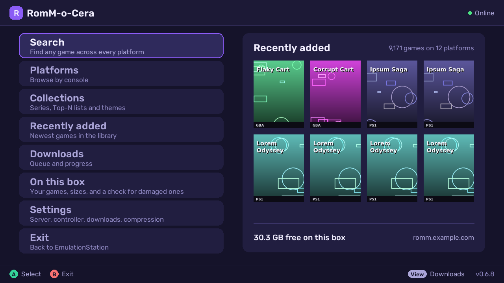
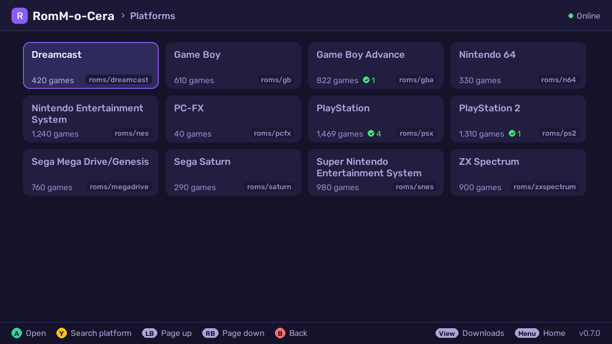
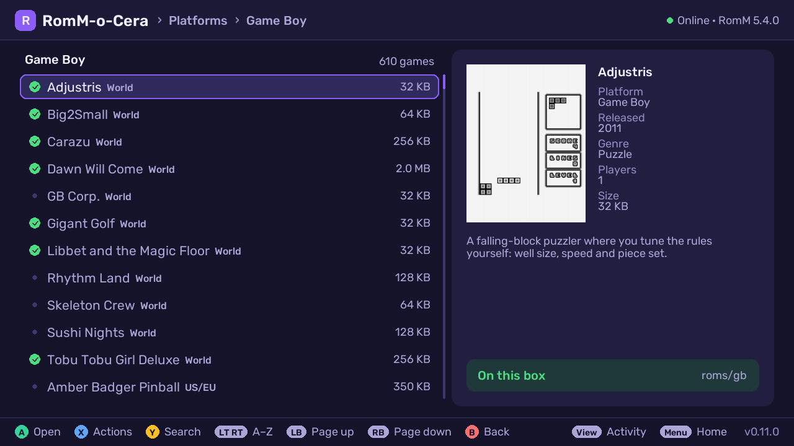
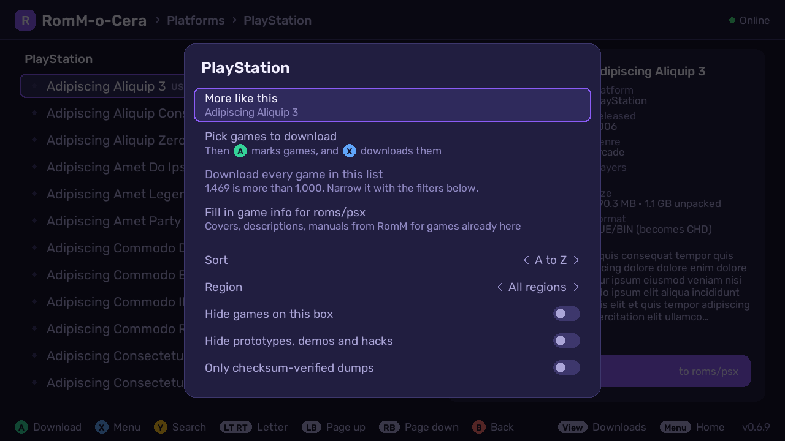
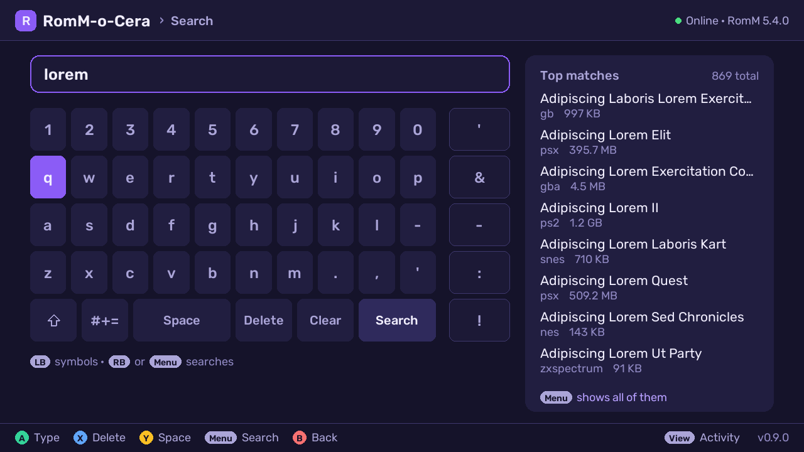
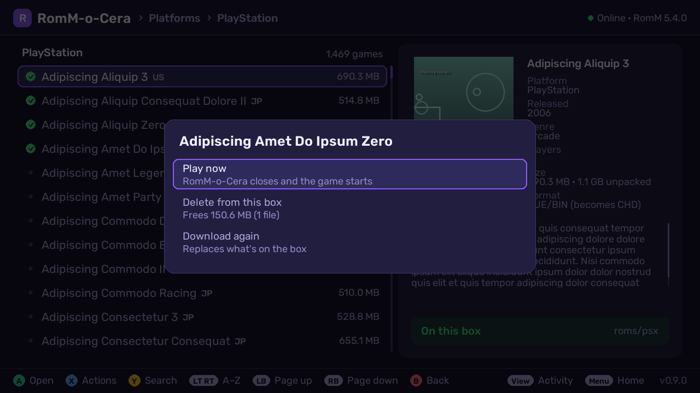
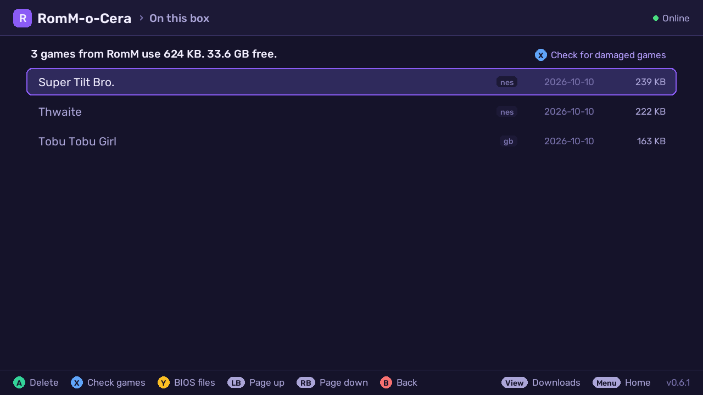
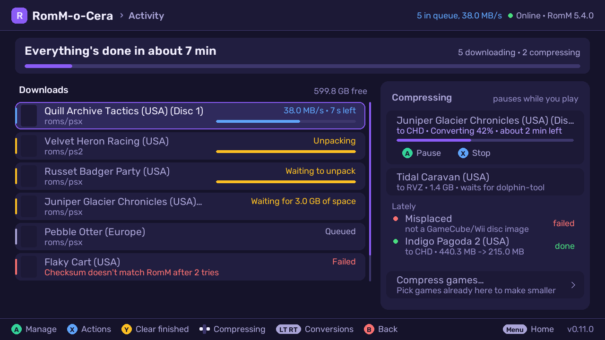
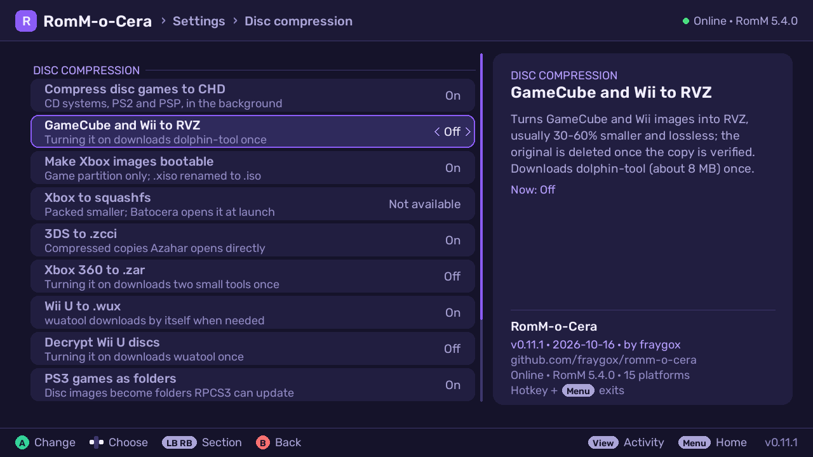
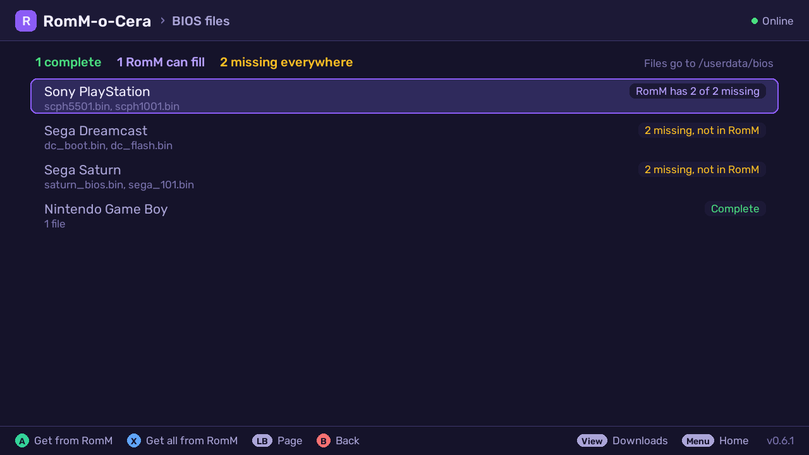

# RomM-o-Cera — a RomM client for Batocera

A controller-driven app that runs **on a Batocera box**: browse and search a
[RomM](https://github.com/rommapp/romm) library from the couch and download
games straight into the right `/userdata/roms/<system>/` folder — extracted,
optionally CHD-compressed, with EmulationStation metadata and cover art.

**Early software (v0.6.5).** It works on the author's box every day, but it
has one author and few users so far — expect rough edges, and please file
issues. Built for **Batocera 43** (pygame 2.6, Python 3.12) against
**RomM 5.3**. Draws natively at any resolution, 720p to 4K.



| | |
|---|---|
|  |  |
|  |  |
|  |  |
|  |  |
|  | |

<sub>Screenshots come from `tools/mock_romm.py`: freely distributed homebrew /
open-source games plus invented "lorem ipsum" titles, with generated covers.</sub>

## Features

- **Browse** platforms (only those with a Batocera system), collections (your
  own, smart collections, and RomM's virtual ones: genre, franchise, series,
  company, game mode), and recently added. **Search** with an on-screen
  keyboard and live top matches. **L2/R2** jump letter by letter.
- **List menu (X)**: more games like the selected one, hide games already on
  the box, filter by region, hide prototypes/demos/hacks, show only
  checksum-verified dumps, pick several games, or download a whole list (up to
  1,000). Bulk downloads estimate the space they'll need once extracted and
  offer to download only what fits.
- **Updates from the box**: Settings → Updates checks GitHub, then downloads,
  verifies and installs a new release in place, keeping the previous version
  for one-step rollback. A daily check flags new releases (turn off with
  `"check_updates": false`).
- **On this box**: everything RomM-o-Cera installed, biggest first, with
  delete. Any game marked ✓ (including ones you copied over before) can be
  deleted from its list; saves and states are always kept.
- **BIOS files** (Settings, or On this box → Y): every system with games on
  the box, what's complete, what's missing that your RomM has (one press to
  fetch, or all at once — matched and verified by checksum), what's missing
  everywhere, and what was fetched when.
- **Multi-disc games** download as a set: one entry in EmulationStation (an
  `.m3u` playlist, the single discs hidden), and the discs you already have
  are reused. "Only this disc" is there too.
- **Downloads** are resumable and **checked against RomM's checksums** (zips
  member by member), retried on network errors, and **keep going after you
  exit** (and while you play — optionally speed-capped), with a popup in
  EmulationStation when they're done. In Downloads: reorder, pause, cancel,
  pause/resume everything, clear finished.
- **Fill in game info** for games already on the box (a platform's list menu,
  or On this box → X for every system): names, descriptions, covers and
  manuals from RomM, matched by file name, added only where missing — your
  own scrapes and edits are never replaced.
- **Download hours** (Settings, off by default): only download in a window,
  e.g. 1–7 am; a transfer running when it closes pauses and picks up the next
  night. "Download now" in Downloads skips the wait for one game.
- **Other versions**: the detail panel tells you when another region or
  revision of the game is already on the box.
- **Manuals and achievements**: a game's manual (PDF) comes along from RomM
  and opens from the game's menu in EmulationStation; the detail panel shows
  how many RetroAchievements it has.
- **Sounds**: soft clicks and chimes while you browse (Settings: on, quiet, off).
- **Check games** (On this box → X): finds missing tracks, damaged zips and
  files that don't match RomM, and downloads damaged ones again.
- **Post-processing**: cartridge zips stay zipped when the system reads them,
  disc archives are extracted, and disc games can be **CHD-compressed in the
  background** while nothing is running (verified before anything is deleted).
- **Button labels match your controller**: Xbox, PlayStation (✕ ○ □ △) or
  Nintendo, picked automatically from the controller's name or set in
  Settings — the hint bar and on-screen text use the same symbols.
- **EmulationStation metadata**: name, description, date, genre, developer,
  players, rating and cover go into `gamelist.xml` once ES is idle.

## Install

### 1. Make a RomM token

In RomM, log in as the user whose library the box should see (a Viewer-level
user is enough). Go to **Profile → Client API tokens → Create** with these
scopes, and copy the token (`rmm_…`). The app only ever reads from RomM.

```
me.read  roms.read  platforms.read  assets.read  collections.read  firmware.read  roms.user.read
```

### 2. Put the app on the box

Pick one:

- **One line over SSH** (root password is `linux` unless you changed it):
  ```sh
  curl -fsSL https://github.com/fraygox/romm-o-cera/releases/latest/download/install.sh | sh
  ```
- **No SSH:** download `romm-o-cera.zip` from the
  [latest release](https://github.com/fraygox/romm-o-cera/releases/latest) and
  copy its `rommbrowser` folder to `\\BATOCERA\share\roms\pygame\` (the
  box's network share).
- **From a clone** (developers): `ROMM_URL=… ROMM_TOKEN=… ./deploy.sh <box-ip>`
  also writes the config for you.

### Updating

On the box: **Settings → Updates**. It downloads the latest release from
GitHub, checks it against the release's SHA256SUMS, confirms every file stays
inside the app folder and compiles, then swaps it in and keeps the previous
version ("Go back to the previous version" appears below Updates). Re-running
the install one-liner works too. Your config, queue and logs are never touched.

### 3. First launch

On the box: **Main Menu → Game Settings → Update Gamelists**, then open
**Pygame → RomM-o-Cera → Settings** and enter your RomM address and token.
**Hotkey + Start** exits.

### Variables

| `deploy.sh` variable | |
|---|---|
| `ROMM_URL` | RomM base URL, `https://…` or `http://…`. Unset = keep the box's current value. |
| `ROMM_TOKEN` | client API token. Unset = keep the box's current value. |
| `ROMM_VERIFY_TLS` | `false` for a self-signed certificate, or a path (on the box) to a CA bundle. |
| `SSH_KEY`, `SSH_USER` | SSH identity / user (default: your ssh config, `root`). |

| `config.json` key (also in Settings) | default | |
|---|---|---|
| `url` | — | RomM base URL |
| `token` | — | client API token |
| `verify_tls` | `true` | `false` or a CA-bundle path for self-signed certs |
| `swap_ab` | `false` | `false`: south button confirms (Batocera's default) |
| `button_style` | `auto` | `auto`, `xbox`, `playstation` or `nintendo` button labels |
| `check_updates` | `true` | daily check of GitHub for a newer release (sends no data beyond the request) |
| `chd` | `true` | background CHD compression of extracted disc games |
| `background_downloads` | `true` | keep downloading after the app exits |
| `speed_while_playing` | `0` | MB/s cap for background downloads while a game runs (`0` = none) |
| `download_hours` | `any` | `any`, or a local-time window like `1-7` / `22-6` |
| `chd_threads` | `auto` | chdman threads: `auto` (N−2 with 6+ threads, N−1 with 3–5) or a number |
| `notify` | `true` | EmulationStation popup when background downloads finish or fail |
| `manuals` | `true` | fetch the game's manual PDF from RomM into `roms/<system>/manuals/` |
| `sounds` | `normal` | UI sounds: `normal`, `quiet` or `off` |
| `cache_limit_mb` | `1024` | cover cache cap in MB; least recently used covers are removed first (`0` = no cap) |
| `platform_map` | `{}` | override the target system per RomM platform slug, e.g. `{"arcade": "mame", "msx": null}` (`null` hides it) |

The app also reads `ROMM_URL`, `ROMM_TOKEN` and `ROMM_VERIFY_TLS` from its
environment (they win over `config.json`), and these paths:
`ROMM_BROWSER_DATA` (default `/userdata/system/romm-browser`),
`ROMM_BROWSER_ROMS` (`/userdata/roms`), `ROMM_BROWSER_SAVES`
(`/userdata/saves`), `ROMM_BROWSER_ES_SYSTEMS` (path to an
`es_systems.cfg`), `ROMM_BROWSER_ES` (ES API, `http://127.0.0.1:1234`),
`ROMM_BROWSER_SCALE` (headless render scale).

### HTTP, HTTPS and certificates

- **HTTPS** (recommended): certificates are verified by default.
- **Self-signed / private CA**: set `verify_tls` to the CA bundle's path on the
  box (best), or to `false` (encrypts, but doesn't check who you're talking to).
- **Plain HTTP** works — use an `http://` URL. The token then crosses the
  network unencrypted, which is fine on a trusted home LAN; Settings shows a
  warning so it's a conscious choice.
- **Batocera's SMB share** (`\\BATOCERA\share`, guest access by default)
  exposes all of `/userdata` — including `config.json` and this app's code —
  to anyone on your LAN. That's Batocera's design, not this app's; if your LAN
  isn't trusted, set a share password / disable the share, and keep the token
  read-only (it is, with the scopes above) so a leak can't change your RomM.
- `user:password@` in the URL is refused: the token is the login.
- Behind an auth proxy (Authelia/Authentik forward-auth…)? The RomM API paths
  must be reachable with just the bearer token; the app reports "Not a RomM
  API response" otherwise.

## Controls

**Controller:** labels follow your controller (Settings → Button labels). South
button confirms (switch in Settings) · East back · Y search · X list menu · L/R
page · L2/R2 previous/next letter · Select downloads · Start home · **Hotkey +
Start exits**. `rommbrowser.pygame.keys` turns off Batocera's pad-to-keyboard
mapping for this app.

**Keyboard:** arrows move · Enter confirm · Esc back · X menu · Y search ·
PgUp/PgDn page · `[` `]` letter jump · Tab downloads · Home home. Search and text
fields take typing directly (Enter runs the search / saves). The hint bar
switches to key names while you use the keyboard. A keyboard and a pad work
side by side.

**Touch / mouse (basic):** tap a list row to select it, tap again to open; tap
menu entries, keys, buttons and the hint bar; tap the logo for Home and the
breadcrumbs to go back; drag or scroll the wheel to move through lists.

## Game info lost after CHD conversion (versions up to v0.6.6)

Up to v0.6.6, a game converted to CHD could lose its EmulationStation info
(description, cover, play count) because EmulationStation saved its own lists
over ours. v0.6.7 hands all game info to EmulationStation through its own API
instead, and ships a one-time repair that finds the lost info in the gamelist
backups and gives it back (only empty fields are filled; play history is
merged; your gamelists are backed up first):

```sh
ssh root@<box>
cd /userdata/roms/pygame/rommbrowser
python3 rb_repair.py --dry-run     # what would be restored
python3 rb_repair.py
```

## Converting an existing library to CHD

```sh
ssh root@<box>
cd /userdata/roms/pygame/rommbrowser
python3 rb_chd_plan.py --dry-run                         # what would be queued
python3 rb_chd_plan.py --systems psx --only "Some Game"  # try one first
python3 rb_chd_plan.py                                   # queue the rest
setsid nohup python3 rb_chd.py >/dev/null 2>&1 &
```

It only converts while no game is running. Progress:
`/userdata/system/romm-browser/romm-browser.log` (`chd: OK … (X GB -> Y GB)`).
A folder holding two releases of a game (say the original and a "Dual Shock
Ver.") becomes one playlist per release. DVD images (PS2) are compressed
without chdman's FLAC codec, which leaks memory in some chdman builds, and
any conversion is stopped if chdman takes more than half the RAM or free
memory runs low (the originals are kept; it's tried again later).

## Files

| File | Role |
|---|---|
| `rommbrowser.pygame` | the UI (Batocera's pygame system runs it) |
| `rommbrowser.pygame.keys` | evmapy override: only Hotkey+Start (exit) |
| `rommlib.py` | RomM API client, platform map, download/extract pipeline, config |
| `rb_finalize.py` | hands game info to EmulationStation through its API once ES is idle |
| `rb_repair.py` | one-time restore of game info lost after CHD conversion (≤ v0.6.6) |
| `rb_chd.py` | background CHD worker |
| `rb_chd_plan.py` | queue an existing library for CHD |
| `rb_dl.py` | background downloader (finishes the queue after exit) |
| `fonts/` | Rubik (SIL Open Font License) |
| `deploy.sh` | copy to a box + write config |
| `tools/mock_romm.py` | fake RomM API with a demo library, for development |
| `tools/shoot.py` | headless screenshot driver |
| `tools/build-release.sh`, `tools/install.sh` | build the release zip / the on-box installer |
| `tools/publish.sh` | maintainer: publish this folder from a monorepo (history replay, or `--snapshot` one commit on top of the remote) |

## Development (no box, no RomM needed)

```sh
python3 -m venv .venv && .venv/bin/pip install pygame==2.6.1 requests pillow
.venv/bin/python tools/mock_romm.py --port 8765 &
ROMM_URL=http://127.0.0.1:8765 ROMM_TOKEN=demo \
ROMM_BROWSER_DATA=/tmp/rb/data ROMM_BROWSER_ROMS=/tmp/rb/roms \
  .venv/bin/python tools/shoot.py /tmp/shots "wait:3,shot:home,act:down,act:ok,wait:2,shot:platforms"
```

`shoot.py` steps: `wait:<s>`, `act:<up|down|left|right|ok|back|x|y|l1|r1|start|select>`,
`type:<text>` (search/edit fields), `shot:<name>`. Add `ROMM_BROWSER_SCALE=3`
to render at 4K.

## Tests

```sh
pip install -r tests/requirements.txt
python -m pytest tests                       # logic + downloads/UI vs the mock RomM
ROMM_CONTRACT_URL=https://romm.example.com ROMM_CONTRACT_TOKEN=rmm_… \
  python -m pytest tests/test_contract.py    # your RomM still has the API the app uses
python tests/contract/disposable.py --tag 5.3.1   # same, against a throwaway RomM (needs docker)
```

The contract tests are read-only and download only the smallest file they find.
`disposable.py` is handy before upgrading RomM: run it with the new tag first.

## License

GPL-3.0 — see [LICENSE](LICENSE). The bundled Rubik font is © The Rubik
Project Authors, under the SIL Open Font License ([fonts/OFL-Rubik.txt](fonts/OFL-Rubik.txt)). Game names in the demo library are
freely distributed homebrew / open-source titles credited to their authors
(descriptions written for the mock) or invented placeholders.
