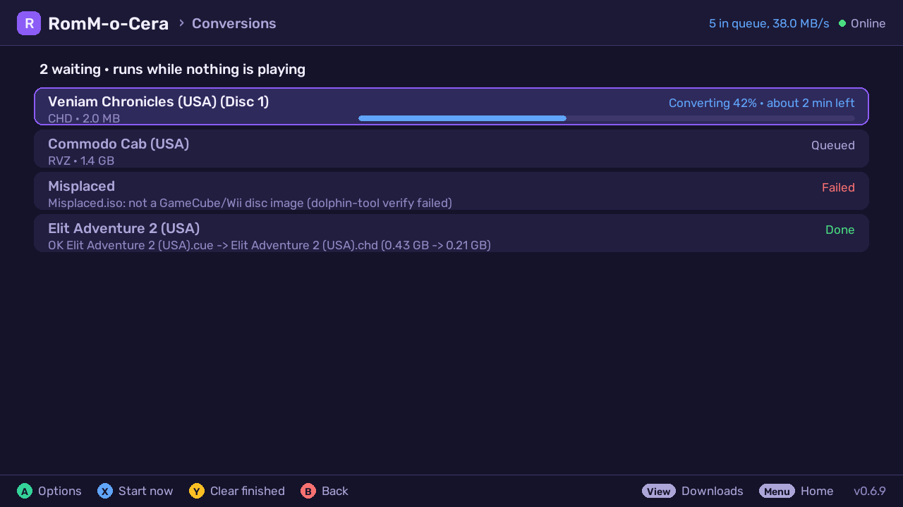
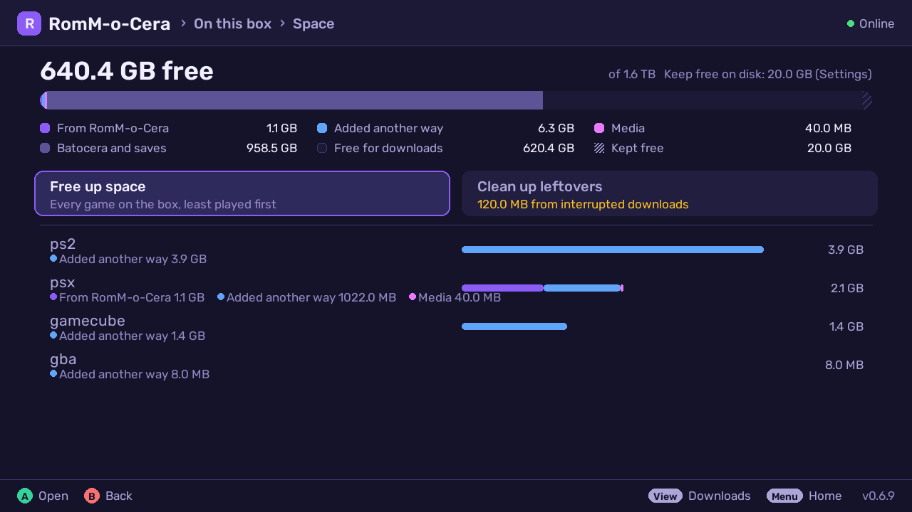
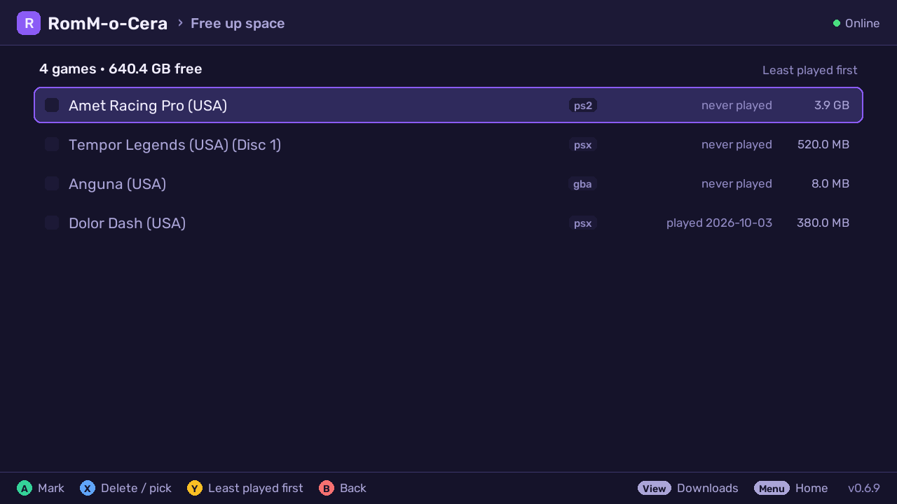
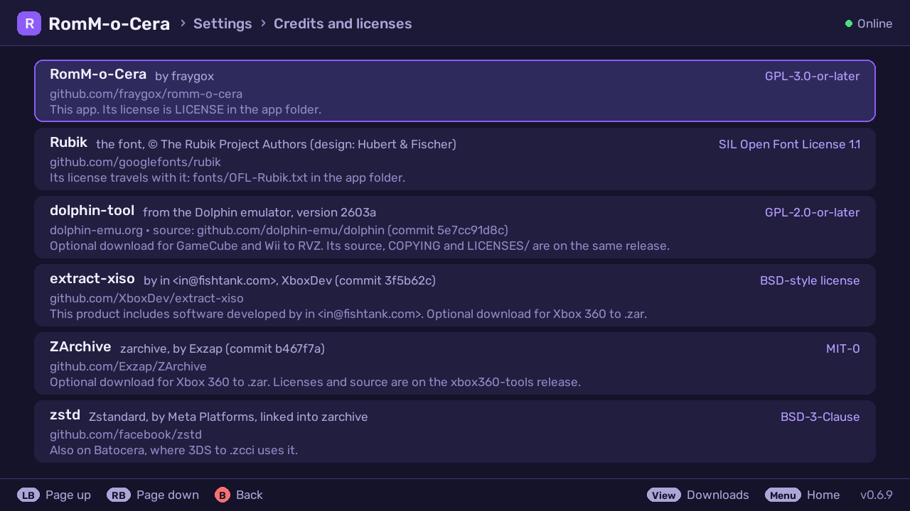

# RomM-o-Cera — a RomM client for Batocera

A controller-driven app that runs **on a Batocera box**: browse and search a
[RomM](https://github.com/rommapp/romm) library from the couch and download
games straight into the right `/userdata/roms/<system>/` folder — extracted,
optionally CHD-compressed, with EmulationStation metadata and cover art.

**Early software (v0.6.8).** It works on the author's box every day, but it
has one author and few users so far — expect rough edges, and please file
issues. Built for **Batocera 43** (pygame 2.6, Python 3.12) and tested
against **RomM 5.4** (5.3 works too). Draws natively at any resolution, 720p
to 4K.


| | |
|---|---|
|  |  |
|  |  |
|  |  |
|  |  |
|  |  |
|  |  |
|  | |

<sub>Screenshots come from `tools/mock_romm.py`: freely distributed homebrew /
open-source games plus invented "lorem ipsum" titles, with generated covers.</sub>

## What it does

- **Browse and search** your RomM library from the couch: platforms,
  collections, recently added, an on-screen keyboard, filters, "more like
  this". → [Browsing and downloading](docs/browsing-and-downloading.md)
- **Download** single games, multi-disc sets (one playlist entry), whole lists
  or whole collections into the right `/userdata/roms/<system>/` folder —
  resumable, checked against RomM's checksums, extracted, with cover art,
  descriptions and manuals handed to EmulationStation. Downloads keep going
  after you exit, wait for space instead of filling the drive, and can be kept
  to overnight hours.
- **Manage the box** from one menu that shows its state at a glance: delete
  games (saves are kept), see where the space went, free up space, clean up
  leftovers, fetch missing BIOS files from RomM, check for damaged or cut-short
  games and replace them.
  → [On this box](docs/on-this-box.md)
- **Compress discs in the background**, lossless and verified: CHD for CD
  systems, PS2 and PSP; RVZ for GameCube and Wii; squashfs for Xbox; .zcci for 3DS; .zar for Xbox 360. Xbox
  downloads are made bootable for xemu. → [Disc compression](docs/disc-compression.md)
- **Feels native**: button labels match your controller (Xbox, PlayStation,
  Nintendo) or keyboard, settings explain themselves, updates install from the
  box with one-step rollback. → [Controls](docs/controls.md),
  [Settings](docs/settings.md)

All the details are in **[docs/](docs/README.md)**.

## Install

### 1. Make a RomM token

In RomM, log in as the user whose library the box should see (a Viewer-level
user is enough). Go to **Profile → Client API tokens → Create** with these
scopes, and copy the token (`rmm_…`). The app only ever reads from RomM.

```
me.read  roms.read  platforms.read  assets.read  collections.read  firmware.read  roms.user.read
```

### 2. Put the app on the box

Pick one:

- **One line over SSH** (root password is `linux` unless you changed it):
  ```sh
  curl -fsSL https://github.com/fraygox/romm-o-cera/releases/latest/download/install.sh | sh
  ```
- **No SSH:** download `romm-o-cera.zip` from the
  [latest release](https://github.com/fraygox/romm-o-cera/releases/latest) and
  copy its `rommbrowser` folder to `\\BATOCERA\share\roms\pygame\` (the
  box's network share).
- **From a clone** (developers): `ROMM_URL=… ROMM_TOKEN=… ./deploy.sh <box-ip>`
  also writes the config for you ([variables](docs/settings.md#deploysh-installing-from-a-clone)).

### 3. First launch

On the box: **Main Menu → Game Settings → Update Gamelists**, then open
**Pygame → RomM-o-Cera → Settings** and enter your RomM address and token.
**Hotkey + Start** exits.

Plain HTTP, self-signed certificates and auth proxies:
[Connecting to RomM](docs/connecting.md).

### Updating

On the box: **Settings → Updates**. It downloads the latest release from
GitHub, checks it against the release's SHA256SUMS, confirms every file stays
inside the app folder and compiles, then swaps it in and keeps the previous
version ("Go back to the previous version" appears below Updates). Re-running
the install one-liner works too. Your config, queue and logs are never touched.

## Documentation

| | |
|---|---|
| [Browsing and downloading](docs/browsing-and-downloading.md) | finding games, the queue, space, download hours, game info |
| [On this box](docs/on-this-box.md) | installed games, space, BIOS, Check games, conversions, game info |
| [Disc compression](docs/disc-compression.md) | CHD, RVZ, Xbox, 3DS, Xbox 360, converting a library you already have |
| [Settings](docs/settings.md) | every setting and `config.json` key |
| [Connecting to RomM](docs/connecting.md) | HTTPS, certificates, network share, auth proxies |
| [Controls](docs/controls.md) | controller, keyboard, touch |
| [Development](docs/development.md) | no-box development, screenshots, tests, files |

## Credits

RomM-o-Cera uses or downloads: Dolphin's **dolphin-tool** (GPL-2.0-or-later,
optional download; its license, the licenses of code it bundles and its
exact source are on the same GitHub release), **extract-xiso** (BSD-style license;
this product includes software developed by in <in@fishtank.com>) and
**ZArchive**'s `zarchive` (MIT-0, with **zstd**, BSD-3-Clause), an optional download
for Xbox 360 to .zar whose licenses and source are on the `xbox360-tools` release,
**chdman** from MAME (BSD-3-Clause /
GPL-2.0-or-later), **pygame**/**SDL** (LGPL-2.1 / zlib), **Requests**
(Apache-2.0) and **7-Zip** (LGPL-2.1) as shipped by Batocera, and the
**Rubik** font (OFL-1.1). It runs on **Batocera.linux** and talks to **RomM**
(AGPL-3.0). The same list is in Settings → Credits and licenses.

## License

GPL-3.0-or-later — see [LICENSE](LICENSE). The bundled Rubik font is © The
Rubik Project Authors, under the SIL Open Font License
([fonts/OFL-Rubik.txt](fonts/OFL-Rubik.txt)). Game names in the demo library are
freely distributed homebrew / open-source titles credited to their authors
(descriptions written for the mock) or invented placeholders.
