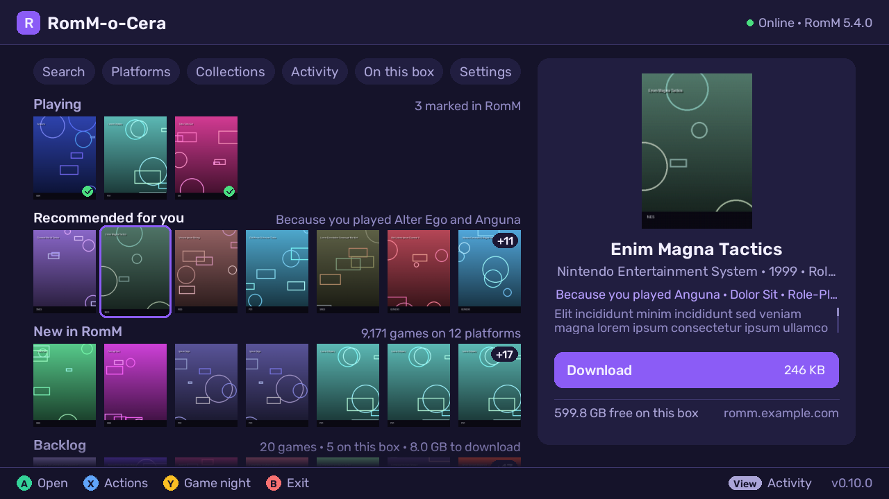
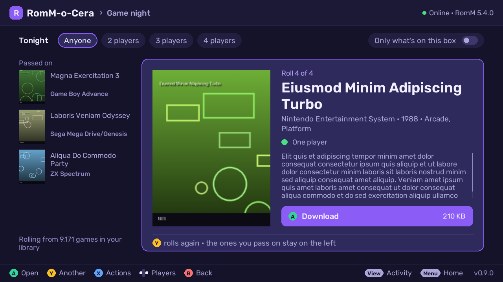
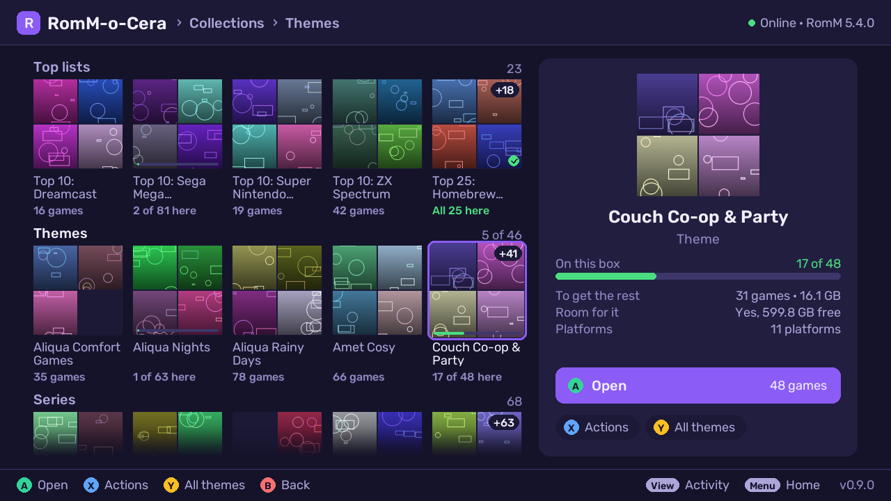

# Browsing and downloading

## Finding games

- **Platforms**: only those with a Batocera system. Each card shows how many
  games RomM has and how many of that system's games are already on the box
  (green). **Y** searches the platform under the cursor, **X** picks a random
  game from it.
- **Collections**: shelves of cover mosaics, a shelf per kind of collection
  (Top lists, Themes, Series, your own kinds, Smart, Browse by), each tile
  with a green line for how much of it is already on the box. See
  [Collections](#collections).
- **Home** is a rail of destinations (Search, Platforms, Collections,
  Downloads, On this box, Settings) over shelves of covers: **Playing** and
  **Backlog** (your RomM statuses, RomM 5 and newer), **Recommended for you**,
  **New in RomM** and **Collections**. A shelf with nothing in it, or one
  your RomM can't list, doesn't show. Up/down moves between the rail and the
  shelves, left/right along one (L/R a page). The panel on the right shows
  what has the focus: a game's cover, your status ("Playing · played here
  today") and its verb (a tap on it plays or downloads); on a rail pill,
  what's behind it. **A** on a game opens [its page](#the-game-page), where
  left/right step along the shelf; **A** on a collection opens it. **X** on
  a game: more like this, or the whole shelf as a list (New in RomM is the
  full **Recently added** list, Backlog opens [Backlog](#backlog)). On a
  touch screen a tap focuses a cover and a second tap opens it; a tap on a
  pill opens it.
- **Recommended for you** (RomM 5.4 and newer): games RomM picks from what
  you play, ranked from its similarity graph and your play history. Its
  list says why for each game ("Because you played …", a series, genre or
  decade, "Highly rated"). Until you've played a few, RomM suggests the
  library's best-rated games. When RomM has nothing to suggest yet (or is
  older than 5.4), the shelf doesn't show.

  

- **Search** (on the home screen) looks through every platform, with an
  on-screen keyboard and the top matches shown as you type (or just type on
  a keyboard). Move right past the keyboard to open a match straight away
  with the pad or arrow keys, or press Start for the full list of results
  ([Controls](controls.md#on-each-screen)). **Y** in a platform's game list
  searches just that platform.
- In any list, **L2/R2** jump letter by letter and **L/R** or left/right
  page ([Controls](controls.md#lists)).

### Game night

Can't decide? Game night rolls a random game and shows it big: cover, name,
platform, year, genre, how many can play and its description. **A** opens its
page (Play now or Download is the big button there; a tap on the pick's own
button does it at once), **Y** rolls another, **B** goes back. The rolls you pass on stay down the left (the last four, until you
leave): **up/down** brings one back.

Across the top: who's playing tonight (**Anyone, 2, 3 or 4 players**, changed
with **left/right** or a tap) and **Only what's on this box**, switched in
**X Actions**. Both roll again when they change and stay set until you exit.
The line at the bottom left says what it's rolling from ("Rolling from 1,234
games in PlayStation, for 2+ players").

Where to find it:

- **Home: Y.** From your whole library.
- **Platforms: X** on a platform: from that platform.
- **Collections: X › Game night** on a collection.
- **A game list: X › Game night.** From the list as it's filtered right now
  (region, hidden prototypes...); Game night's own players and on-the-box
  choices replace the list's.

Only games with a Batocera system come up. RomM 5.4 picks the game itself;
with an older RomM the app picks from the list's pages.

### Backlog

**Collections › Your RomM lists › Backlog** lists the games you marked
Backlog in RomM, in RomM's order: a cover, on-the-box tick or size, and
**Waits for space** in amber for those that won't fit yet. The panel sums up
**Download my backlog** (**Y**): the total, how many aren't here yet, what
fits now and what waits (against the space left once the queue has landed,
keeping Settings' keep-free space), and a line per platform. Everything is
queued in that order (up to 1,000); the ones that don't fit wait for room.
**X Actions** has Free up space. **A** opens the selected game's page.

## Collections

Your RomM collections as shelves of cover mosaics, one shelf per kind:
**Top lists**, **Themes**, **Series**, then any kind of your own, **Your
collections** (the ones without a kind), **Smart** (RomM's smart
collections) and **Browse by** (RomM's own groupings: genre, franchise,
series, company, game mode; and your Backlog). Every tile carries a thin
green line along its foot for how much of that collection is on this box
(a tick when all of it is), with the count under its name ("17 of 48
here"). Up/down move between shelves, left/right along one, L/R a page.

The panel on the right is the focused collection: its mosaic, how many of
its games are on this box, the number and size of the rest, whether that
fits in the space left, and its platforms (the size and platforms appear a
moment after a tile gets the focus, once its games have been read).

- **A** opens the collection: its games as a list, with pills across the
  top, **All / On this box / Not here**, each with its count (**Y** switches
  them, or tap one). **A** on a game opens its page.
- **X Actions**: Open, [Compare with RomM](#compare-with-romm), Game night
  from this collection, and **Download the rest** (how many and how big,
  skipping what's here already; a collection of more than 1,000 games: open
  it and filter first).
- **Y** turns the focused kind into a wall, six tiles a row with a scrollbar
  (handy with 60 themes or 90 series), and back to the shelves.
- A **Browse by** door opens that grouping as a wall; each of its groups
  opens like any collection.

### Naming collections for the shelves

The shelf a collection lands on comes from its name in RomM. A name of the
form `Kind: Name` puts it on the shelf for that kind, and the tile shows
just the name after the colon:

| Name in RomM | Shelf | Tile |
|---|---|---|
| `Top 10: Platformers`, `Top 100: PlayStation` | Top lists (sorted by the number, then the name) | the whole name, the number matters |
| `Theme: Hidden Gems` | Themes | Hidden Gems |
| `Series: Dolor` | Series | Dolor |
| `Picks: Rainy Day`, `Picks: Sunday`, `Picks: Late` | Picks, a shelf of its own | Rainy Day, Sunday, Late |
| `Weekend Favourites` | Your collections | Weekend Favourites |
| `Lorem: Best Of` (only one with that prefix) | Your collections | Lorem: Best Of |

The rules:

- `Top N` (any number, `Top10` and `Top 10` alike), `Theme` and `Series`
  always count as kinds. Any other prefix becomes a kind of its own once
  **three or more** collections share it; those shelves come after Series,
  A–Z, named after the prefix as you first spelled it. With fewer, the colon
  is just part of the name and the collection stays in Your collections.
- Case and spaces around the colon don't matter: `theme : Cosy Nights`,
  `THEME:Cosy Nights` and `Theme: Cosy Nights` all land on Themes, as
  "Cosy Nights".
- Within a shelf, collections are sorted by name (Top lists by their number
  first). An empty collection shows nowhere.
- Smart collections (RomM 5 and newer) go on the Smart shelf as named;
  RomM's virtual collections are behind the Browse by doors.

## The detail panel

Beside every list: cover, description, players, release date and genre, how
many RetroAchievements the game has, whether its manual comes along, and for
disc games the format and what it becomes on the box, for example
"2 discs, CUE/BIN (becomes CHD)", with the size once unpacked (exact when RomM
lists the archive's contents, "~" when estimated). It also tells you when
another region or revision of the game is already on the box.

## The game page

**A** on a game anywhere (a list, a Home shelf, Game night, Backlog, Games
from RomM) opens its page: the cover
over a soft backdrop, its facts and description, and your side of RomM in
one strip: your status (Playing, On your backlog, Finished…), your rating,
your newest note, and your RetroAchievements progress. Up to three
screenshots sit under it, and a QR code opens the game's page in RomM on
your phone. Anything RomM doesn't have is left out.

- **A** is the game's one action: **Download** (A again in the prompt
  downloads it), or **Play now** when it's on the box. Then the facts set the
  box's copy beside RomM's ("On this box: CHD · 257 MB · roms/psx", "In RomM:
  zip · 515 MB") and the strip says when you last played it here.
- **X** opens the game's Actions: More like this, Game night (from the list
  it came from), and for a game on the box Delete and Download again.
- **Left/right** go to the previous or next game of the list; **B** goes back.

While picking several games, A still picks.

## The Actions menu (X)

Press **X** in a game list for its Actions menu. Filters change the list in place
and the menu stays open; the actions close it.

- **More like this**: games similar to the selected one.
- **Game night**: roll a game from the list (see [Game night](#game-night)).
- **Filters**: hide games already on the box, pick a region (USA + World,
  Europe + World, Japan), hide prototypes/demos/hacks, show only
  checksum-verified dumps; in a platform's list and Recently added, sort by
  name or newest first.
- **Players** (the party filter): only games for 2+, 3+ or 4+ players, going
  by the player counts in RomM's game info (games without one are left out).
  The list's header shows it while it's on ("2+ players, 312 games"), next
  to the region. Like the other filters it applies to that list until you
  leave it.
- **Pick several games**: **A** then picks games, and **Download … picked**
  in this menu downloads them together (see
  [Controls](controls.md#picking-several)).
- **Download every game in this list** (up to 1,000).
- **Compare with RomM** (a platform's or a collection's list): see
  [Compare with RomM](#compare-with-romm).
- **Fill in game info** for this system's games already on the box (see
  [On this box](on-this-box.md#fill-in-game-info)).
- **Get BIOS for** the platform, when the box is missing BIOS files that
  your RomM has (checksum-verified; all systems: [On this box](on-this-box.md#bios-files)).

**Download a whole collection** straight from Collections: X on a collection,
then Download the rest (up to 1,000 games; a bigger one: open it and filter
first). Inside a collection the same entry is in its Actions menu.

Bulk downloads estimate the space they need once extracted and offer to
download only what fits.

### Compare with RomM

**Compare with RomM** (X in a platform's or a collection's game list, or X on
a collection) lists the games of that platform or collection that are on the
box, each against RomM's copy. It works per platform or collection on
purpose: on a big library one list of everything would be too long to use.
The pills on top (**Y** switches them, or tap one) filter by state, each with
its count:

- **Matches RomM**: the same file RomM has, or *Matches RomM (compressed)*:
  RomM's game, compressed here by the app (a .chd from RomM's .zip). Nothing
  to do.
- **Newer in RomM**: RomM's file changed since this one was downloaded (or a
  file copied over by hand has RomM's name at another size). **A** (*Get the
  newer one*) downloads it again through the usual download dialog and
  replaces the copy here; saves are kept.
- **Not in RomM** (platforms only): a game put on the box another way. It
  still plays.

The panel shows both copies (format, size, folder, when it came here and when
RomM last changed it) and says in one sentence what it means. RomM's list is
read in the background; **B** stops it. **Compare again** is in the X menu.

## Downloading

- The download prompt says what you're getting: the download size, the size
  once unpacked ("about" when it's an estimate, "up to" for a Wii U zip whose
  contents aren't known yet), whether it'll be compressed in the background, and the free
  space left afterwards.
- **Multi-disc games** download as a set: one entry in EmulationStation (an
  `.m3u` playlist, the single discs hidden), and discs you already have are
  reused. "Only this disc" is there too.
- Downloads are **resumable**, **checked against RomM's checksums** (zips
  member by member) and retried on network errors. When RomM (or the proxy
  in front of it) says it's busy, the app sends it fewer requests at once
  and tries again after the wait it asks for, for covers, lists and
  downloads alike. A cover that didn't come is asked for again a little
  later, so a hiccup doesn't leave "no cover" for the rest of the session. One that grows past the
  file's size RomM gave stops at once ("The server sent more than the file's
  size"), so a broken server can't fill the drive.
- They **keep going after you exit** and while you play (optionally
  speed-capped while a game runs), with a popup in EmulationStation when
  they're done. If they're stuck on something only you can fix (the drive
  is full, or RomM no longer accepts the box's token), EmulationStation
  shows a message box once you're back in its menus.
- **Download while extracting** (Settings, on by default): the next game
  downloads while the last one unpacks. Turn it off for slow storage (SD
  cards, USB sticks).
- Cartridge zips stay zipped when the system's emulator reads them (the one
  chosen in Batocera for that system, else its default: N64's default,
  mupen64plus, can't, so N64 games are unzipped); disc archives are
  extracted, and disc games can be compressed in the background (see
  [Disc compression](disc-compression.md)).
- An archive never unpacks into another game's folder. If its folder name is
  already taken by a different game, the download stops with "… is already on
  the box under that name" instead of mixing the two. Archives that would
  unpack over EmulationStation's files, and 7z/rar archives that contain
  links, are refused.
- Manuals (PDF) come along from RomM and open from the game's menu in
  EmulationStation.

### Play now

A game you've just downloaded can start straight away: **Play now** is in
the game's page (A on a game on the box), in its row's menu on the Downloads
screen, and the "Ready" toast says so (tapping the toast plays it).
RomM-o-Cera closes and EmulationStation starts the game a few seconds later.
If other downloads are still running it asks first: they keep going in the
background while you play, or, with **Keep downloading after exit** off,
pause and resume next time you open RomM-o-Cera.

It starts what EmulationStation lists for the game: the `.m3u` playlist of a
multi-disc game (once every disc is here), a PS3 `.ps3` folder, or the
converted file (CHD, RVZ, .zar, .wua…). A game that's waiting to be
compressed, or being compressed, can't start until that's done, and the menu
says so. A new download isn't in EmulationStation's lists until RomM-o-Cera
hands it over after closing, so the game starts once EmulationStation lists
it and its game info and images are written (up to 10 minutes on Batocera
43.1, which reloads every list for it); starting another game meanwhile
cancels it, and a popup says where to find the game if it isn't ready by
then. Where EmulationStation asks
before starting a game (a system with missing BIOS files), it asks then too.

### Activity: downloads and compressing

**Select** opens it from anywhere (Home's Downloads too). The line on top says
when everything is done (downloads at their smoothed speed, plus the running
conversion and the ones queued behind it), with one bar for all of it.
Downloads are on the left, what this box is compressing on the right;
**left/right** moves between them.

On the left, the queue comes first, in the order it
runs, then finished downloads, newest first. **A** on a download gives its
options: move it to the top, up or down, Download now (outside the download
hours), pause, resume, cancel, retry, or remove it from the list. The **X**
menu pauses or resumes everything and clears finished ones (so does **Y**).
Pick several (X › Pick several) to pause, resume, cancel, retry or remove
them at once; cancelling (one or several, active or paused) asks first, since it
deletes the partial files. Each game shows what it's being compressed to (CHD,
RVZ, squashfs, .zcci, .zar, .wux, .wua, a `.ps3` folder) and when that's done. A
finished game's menu has [Play now](#play-now). A failed download says why
under its name.

On the right, **Compressing**: the running conversion with its progress and time
left (**A** pauses or resumes it, **X** stops it: what's made so far goes, the
original stays, and Conversions can queue it again), the queue (**A** converts
it next, **X** takes it out), what finished lately, and **Compress games…**
(**Y**) to pick games already on the box. A pause lasts until you resume, even
across restarts; conversions also pause by themselves while a game runs. L2/R2
opens **Conversions** ([On this box](on-this-box.md#conversions)).

### Space

**Keep free on disk** (Settings, default 20 GB): downloads and conversions
never leave less than this free. A download that doesn't fit waits ("Waiting
for space") and starts once there's room; smaller ones behind it keep going.
Activity shows the space free (or how much the queue is short by), and
adding a game the queue can't fit warns you. An archive counts what it
really unpacks to: RomM's list of its contents, or, when RomM has none (Wii U,
for one), the zip's own list, read from RomM in the background before the
download starts (a few small requests, not the download). Until it's read, or
when it can't be (a 7z, or a server that won't send part of a file), a zipped
Wii U game counts as a whole disc image ("up to 23.3 GB", the size of every
`.wud`) and anything else about 2.2 times the download. A zip is deleted
once it's unpacked, so the queue counts only the biggest zip beside its
contents, plus what every game unpacks to. Conversions waiting for room
start as soon as you free some.

### Download hours

Settings, off by default: only download in a window, e.g. 1–7 am. A transfer
running when the window closes pauses and picks up the next night.

## Game info in EmulationStation

A downloaded game's info and media from RomM are handed to EmulationStation
through its own API once it's idle — never by editing `gamelist.xml` behind
its back, which EmulationStation could overwrite. What ES already has for a
game (your own scrapes, an image) is never replaced.

| EmulationStation | From RomM |
|---|---|
| name, description, release date, genre, developer, publisher, players, rating | the game's info |
| region | its first region with a code ES knows: `us`, `eu`, `jp`, `wr` (World)… — ES shows its flag |
| language | its languages as `en`, `fr`, `jp`…, several joined: `en,it` |
| game family | its first franchise |
| image | its first screenshot; the cover when it has none |
| thumbnail (Box) | the cover (the box art), else ScreenScraper's 2D box |
| marquee (Logo) | the logo (wheel), else the marquee |
| title shot | the title screen |
| alt box art | the 3D box |
| box back, fan art, cartridge | the box back, fan art, physical media |
| video | the video clip (MP4 up to 50 MB; a bigger one is skipped) |
| manual | the PDF manual (Settings → Download manuals) |

Only files RomM keeps itself are used, through your RomM login like covers —
never the upstream links in RomM's records. Which of these RomM has depends on
its own settings: the screenshot, box art and manual by default, the logo,
title screen, 3D box, fan art and video when RomM's `config.yml` lists them
under `scan: media:` (`logo`, `title_screen`, `box3d`, `fanart`, `video`…)
and the game was scanned since. A game RomM has nothing more for gets what it
has, and [Fill in game info](on-this-box.md#fill-in-game-info) brings the rest
to games already here once RomM has it.
New downloads are added to EmulationStation's lists on their own, so it
doesn't reload every system for them. Batocera 43.1's EmulationStation can't
add games this way (a bug fixed after it), so there it reloads its lists as
before, as it does everywhere after games are compressed or deleted.

RomM-o-Cera stays out of EmulationStation's way: game info waits until ES is
idle, and background compression pauses while a game runs and while ES
scrapes, installs, computes RetroAchievements hashes or updates Batocera
([Disc compression](disc-compression.md)).

## Updates

**Settings → Updates** checks GitHub, then downloads, verifies and installs a
new release in place, keeping the previous version for one-step rollback.
The app closes and opens again by itself on the new version; downloads
carry on where they were.
The swap is a single step where the drive allows it, so a power cut mid-update
never leaves the box without the app. **Update channel** picks what it
offers: *Stable* releases, or *Nightly* builds of the newest changes as they
land. A daily check flags a newer version on your channel (turn it off with
**Check for updates daily**; Updates still checks when you select it).
After an update, **What's new** shows the new version's release notes once at
start (A or B continues; X shows a QR code of the full notes on GitHub). Without
a connection it waits for the next start, and Settings → Updates → **What's new
in this version** shows them any time.
Details in the [main README](../README.md#updating).
