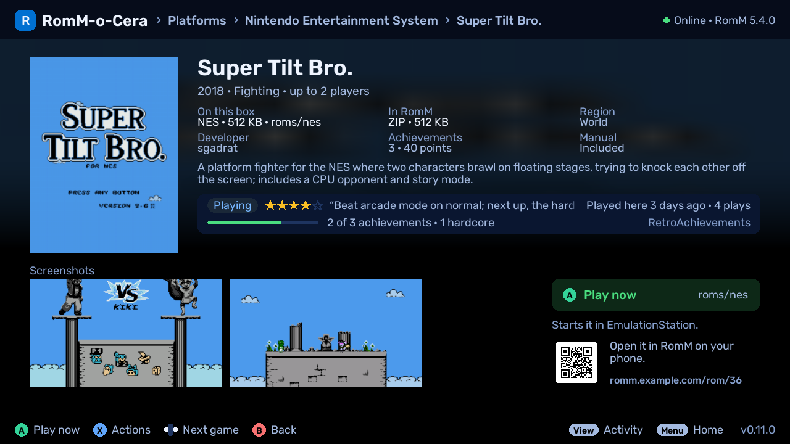
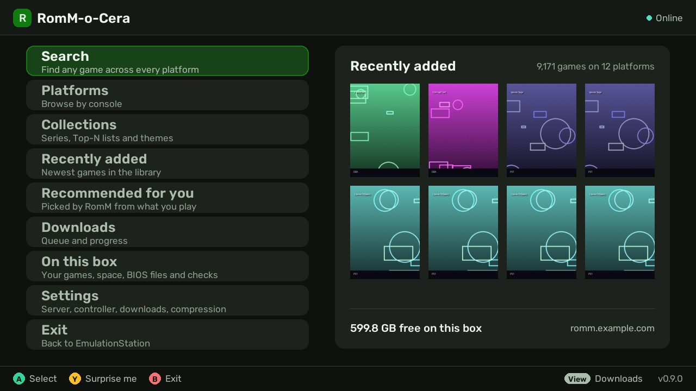
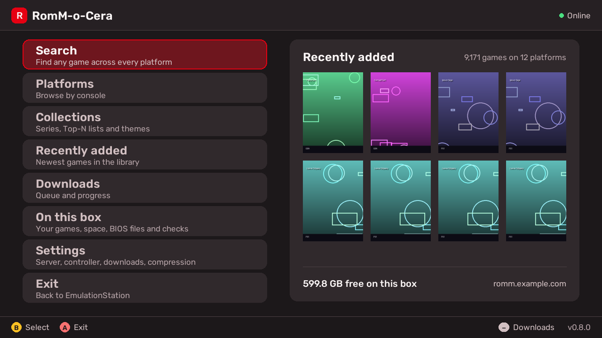
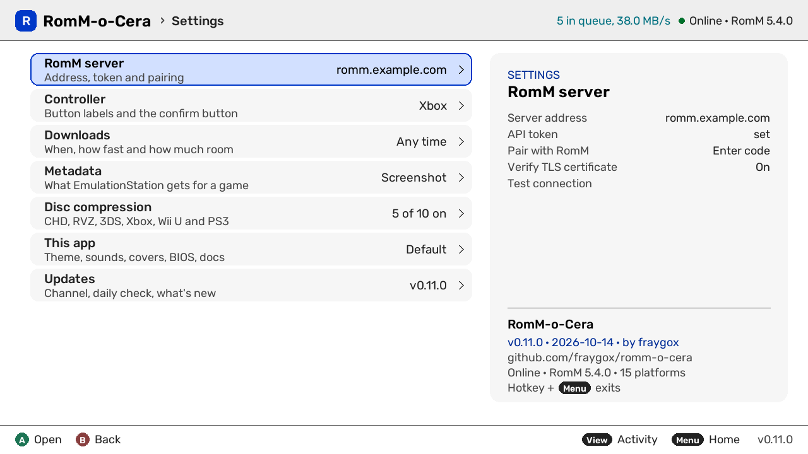

# Themes

The whole app can wear a different set of colours. Open **Settings → Theme**
and press A for the theme picker, or press left and right on the Theme row to
step through the themes without opening it. Every theme keeps text at least
as easy to read as Default, and warnings never share a colour with the
highlight. A new install starts on Default.

## The theme picker

Every theme is a card with a small picture of the app in its colours, in
groups. Moving onto a card puts the whole app in that theme straight away,
so you see it for real before you keep it. The panel beside the cards names
the theme, says what it's after, shows what its colours mean (focus, ready,
working, problem, info) and a list row at its real size. A tick marks the
theme you use now.

| Button | What it does |
|---|---|
| **A** | Keep this theme (on the Custom card: open it) |
| **B** | Back, with the theme you had |
| **Y** | Switch the card to its OLED version, or back (only on cards with an OLED pill) |
| **X** | Edit a copy: start your Custom theme from this one |
| **L / R** | The previous or next group |
| D-pad | Move round the cards |

Start (Home) also leaves the picker without changing your theme. On a touch
screen, tap a card to try it and tap it again to keep it; tap its OLED pill
to switch it, and the panel's **Edit a copy** button does what X does.

**OLED** versions use a pure black background, for OLED TVs and dark rooms.
Default, PlayStation, Xbox and Kyoto have one; Red Visor comes only in OLED.
If your theme is an OLED one, every card starts on its OLED version.

## Every theme

**Built in**

- **Default**: RomM's violet on deep indigo.
- **PlayStation**: deep blue, with cyan for work in progress.
- **Xbox**: green on graphite, with mint for what's done.
- **Kyoto**: bold red on warm charcoal, with warnings in coral so they never
  look like the highlight.
- **High contrast**: pure black and white with a yellow highlight.
- **High contrast light**: black on white with a blue highlight, for bright
  rooms.

**Consoles**

- **Brick**: the pea-green handheld screen, four greens.
- **Red Visor OLED**: red on true black.
- **Red & White**: maroon and cream with a touch of gold.
- **Lavender**: 16-bit greys with lavender and purple.
- **Mega Drive**: black, chrome and red.
- **Dreamcast**: a light theme, white with orange.
- **Indigo Cube**: a deep indigo, a touch lighter than the console.
- **Sixty-Four**: charcoal and green.
- **TurboGrafx**: black and orange.
- **Neo Geo**: arcade black and gold.
- **Atari 2600**: woodgrain brown and orange.
- **Commodore 64**: light blue on the boot screen's blue.

**Screens and moods**

- **Green phosphor**: a monochrome terminal, glowing green.
- **Amber monitor**: the warm amber CRT.
- **Synthwave**: magenta and cyan on deep purple.
- **Sakura**: soft blossom pink on a warm dusk.

**Classic palettes**

- **Nord**: arctic blue-greys, calm and low-glare.
- **Solarized**: the classic palette, dark.
- **Dracula**: purple-grey night with pink and green.
- **Paper**: a warm light theme for bright rooms.

**Yours**

- **Custom**: your own colours (below).

| | |
|---|---|
|  |  |
|  |  |

## Custom

**Custom**, the last card, is a theme you make from four choices. Press A on
its card to open it:

- **Accent colour**: the highlight, the logo and progress bars, picked round
  the colour wheel.
- **Background tint**: the hue the backgrounds and greys lean toward.
- **Tint strength**: from neutral grey to fully tinted.
- **Mode**: Dark, OLED (pure black) or Light.

Up and down pick a choice; left and right change it (15° round the wheel, or
10% of strength), and L and R take bigger steps (60°, or 30%). On a touch
screen, tap a colour, a step of the strength bar or a mode. The whole app
shows your colours as you change them. **A** keeps them and switches to
Custom; **B** leaves Custom as it was.

You can't make it hard to read: every colour is worked out from your four
choices, then nudged until it's as readable as Default, and warnings are
kept apart from your accent. Custom is saved in `config.json` as four
`theme_custom_` settings ([the keys](settings.md#configjson)).

### Edit a copy

**X** on any other card (or its **Edit a copy** button) starts Custom from
that theme. The accent takes the theme's accent, the tint and its strength
are worked out from the theme's backgrounds, and the mode follows its
background: pure black gives OLED, a light one gives Light, anything else
Dark. To copy a theme's OLED version, switch its card to OLED first.

The Custom screen then opens on those colours and says which theme they came
from, for you to tweak. Nothing is saved until you press A there; B goes
back to the picker with your Custom theme as it was, and so does Home. The
copy comes close rather than exact, because Custom's levels of light and
dark are fixed: themes with unusually bright backgrounds (Commodore 64,
Indigo Cube) or strict rules (High contrast) come out a little deeper.

## Match theme to controller

**Settings → Match theme to controller** (off by default) shows the theme
made for the controller you're holding instead of your Theme: PlayStation,
Xbox, or Kyoto for a Nintendo controller. If your Theme is an OLED one, you
get the OLED version. It changes as soon as a controller connects or
disconnects, and the Theme row shows what's on screen, for example
"Default (now PlayStation)".

- With no controller connected, or one whose name doesn't say who made it,
  your Theme stays.
- When **Button labels** is set by hand, the theme follows that instead of
  the controller.
- High contrast themes are never replaced.
- Your Custom theme is replaced like any other, so turn this off to see it.

If you keep a theme in the picker while this is on and your controller has
its own theme, the app says so: your choice is saved, and shows again when
you turn the switch off or use another controller.
